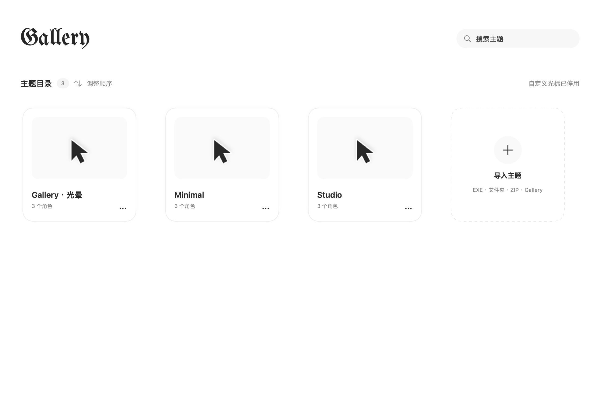

<div align="center">
  
  <h1>Gallery</h1>
  <p><b>为 Mac 换一套有动画的鼠标指针。</b></p>
  <p>Windows 光标导入 · 点按与待机动画 · 热点和逐帧编辑 · 主题橱窗</p>
  <p><b>简体中文</b> · <a href="README.en.md">English</a></p>
  <p>
    <a href="https://github.com/Danningcarer/Gallery/releases/latest"></a>
    
    
    <a href="LICENSE"></a>
  </p>
  <p><a href="https://github.com/Danningcarer/Gallery/releases/latest"><b>下载最新版</b></a> · <a href="#quick-start">快速开始</a> · <a href="https://github.com/Danningcarer/Gallery/issues/new/choose">反馈问题</a></p>
</div>



Gallery 是基于 [Mousecape](https://github.com/alexzielenski/Mousecape) 扩展的 macOS 鼠标指针美化与编辑工具。它把常态、待机和按下／按住／松手动画、Windows 素材导入以及可视化编辑放在同一个应用里。界面支持**简体中文和英文，自动跟随 macOS 的语言偏好**，也支持系统的按应用语言设置。

<a id="quick-start"></a>
## 快速开始

1. **安装**：从 [Releases](https://github.com/Danningcarer/Gallery/releases/latest) 下载 `Gallery-macOS.zip`，解压后将 `Gallery.app` 放入「应用程序」。需要 macOS 14 或更新版本，支持 Apple 芯片与 Intel。
2. **导入**：点击右上角 **＋** 选择文件或文件夹，也可以拖入窗口。首次打开导入界面会显示完整说明，以后可点击旁边的 **ⓘ** 查看。含多套素材时先勾选需要的套装和版本，按需点预览。
3. **使用**：单击卡片选中主题，点右上角 **▶** 开始使用。再次点击已选中或正在使用的卡片进入编辑；点 **⏸** 停用并恢复。关闭窗口后仍可从菜单栏控制。

内置示例由本项目绘制，不需要另外下载素材。只锁定正在使用的主题，暂停它后即可编辑；其他主题可以直接修改。

## 主要功能

| | 可以做什么 |
| --- | --- |
| 动画 | 常态循环、待机、按下、按住、松手；有按住素材就持续播放到松手，各角色可单独设置待机等待时间 |
| 可视化编辑 | 点选或输入热点，调整尺寸、帧时长，复制／替换／追加／移动／删除当前帧，预览完整动画 |
| 大小与外观 | 每个主题独立的整体大小和每个角色独立大小，均为 25%–300%；可选抗锯齿与柔和阴影 |
| 主题橱窗 | 静态封面、自选封面帧、搜索、拖动排序、重命名、导出、整套移入废纸篓 |
| 角色混搭 | 单个角色选用其他主题的素材，或保留原生光标；一个角色的多套素材可自由切换 |
| 日常使用 | 登录自启动、启动后自动应用、启用时隐藏 Dock 图标、甩动放大、按应用暂停交互动画 |

包括正常、帮助、链接、后台运行、忙、精准／文本选择、移动和各方向调整等角色。Windows 专有角色也会保留为可编辑素材；实际显示哪些角色由 macOS 和前台应用决定。

## 导入支持

**Gallery 仅读取素材，不运行 Windows EXE、DLL 或 INF 指令。** 壁纸、应用图标及其他程序会被跳过，原始文件不变。

| 输入 | 支持内容 |
| --- | --- |
| `.gallery` / `.cape` | Gallery 的完整主题与素材版本；Mousecape 的常态光标 |
| `.cur` / `.ani` | 单个静态或动态光标；ANI 帧序列、时长及热点 |
| 文件夹 / `.inf` | 读取 CUR／ANI 及配套安装配置；含多个配置套装时分别选择导入 |
| `.zip` | 常用压缩、ZIP64、Unicode 和常见旧式中文文件名；只展开需要的内容 |
| `.exe` | 支持的 .NET 资源、.NET 单文件、Inno Setup 和 ZIP 自解压安装包 |
| 编辑器内导入 | PNG 帧序列、GIF、CUR 和 ANI，可追加或替换动画 |

外层 ZIP／EXE 上限 **2 GB**；单个光标文件 40 MB、通常每套展开素材 80 MB，素材数量和图像尺寸另有限制。多版本素材先选择再导入，每套分别加入橱窗。其他封装、加密包、下载入口或损坏文件可能无法直接读取，可改用解压后的 CUR／ANI 文件夹。完整格式与边界见[兼容说明](Documentation/COMPATIBILITY.md)。

## 权限、隐私与恢复

- **输入监控**用于只读鼠标事件监听。Gallery 不记录键盘、不拦截点击，不要求辅助功能权限。不开启时使用备用鼠标事件与计数路径，部分应用中的响应可能不同。
- **主题留在本机**。应用不上传导入的光标素材，也不需要在线主题服务。
- **启用前备份，停用时恢复**。正常停止或退出会恢复原光标；崩溃或强退后，重新打开 Gallery 并使用恢复操作。避免同时运行其他自动重应用光标的软件。
- **兼容性边界**：应用使用私有 macOS 光标接口。部分应用自绘光标、系统安全界面可能保留原生指针，系统更新也可能影响兼容性。

当前发布包采用临时签名，**尚未 Developer ID 公证**。macOS 可能要求在「隐私与安全性」中确认打开；请从本仓库 Releases 获取应用，无需关闭系统安全保护。

## 常见问题

<details>
<summary>为什么只有静态光标，或某个角色不播放动画？</summary>

先确认主题已启用、角色选中了动态素材，并且对应动画状态中有帧。只有一帧的素材不会播放常态循环。前台应用负责选择系统角色，Gallery 不读取页面内容来推测链接；应用自绘或未知光标可能暂时使用原生显示。输入监控可改善跨应用的鼠标事件响应。

</details>

<details>
<summary>为什么不能编辑某个主题，或预览按钮不可用？</summary>

正在使用的主题需要先停用，才能编辑素材或播放编辑器预览。其他主题仍可编辑。整体和角色大小可以在使用时调整。隐藏、失焦或打开设置时，动画预览会暂停以减少消耗。

</details>

<details>
<summary>外观设置为什么没有立即改变所有缩略图？</summary>

抗锯齿或阴影变更后，封面和角色缩略图会在后台重新生成，源素材不会被改写。旧主题库首次重建可能需要稍等；正在使用的主题需暂停后修改外观，再重新应用。

</details>

<details>
<summary>如何彻底恢复系统光标？</summary>

使用工具栏或菜单栏中的「停用并恢复」，或正常退出。强退后重新打开应用并选择恢复。若其他软件也在更换光标，先将其停用；会话资源无法恢复时可注销再登录。

</details>

## 性能

优先顺序为**点按响应 → CPU／能耗 → 体积**。位置与合成由 macOS 负责；短常态动画使用系统播放，其他动画复用有界资源缓存。静态橱窗不循环刷新，素材预览仅按需播放。

1.0.1 减少重复的状态文字生成、调度临时分配和屏幕信息查询，不提高轮询频率、不降低动画帧率，保留已验证的播放与恢复路径。测量范围、结果与局限见[性能记录](Documentation/PERFORMANCE-1.0.1.md)。

## 构建与检查

需要 **Xcode 26.2+ 或对应 Command Line Tools**；部署目标为 macOS 14。导入辅助程序首次构建会下载并验证固定版本的依赖，应用运行时不依赖 Homebrew。

```sh
git clone https://github.com/Danningcarer/Gallery.git
cd Gallery
bash Scripts/check.sh
bash Scripts/localization-check.sh
GALLERY_UNIVERSAL=1 bash Scripts/build.sh
```

产物为 `dist/Gallery.app` 和 `dist/Gallery-macOS.zip`，调试符号单独保留在 `dist/Symbols`。默认核心检查和语言检查不更改系统光标；需要界面会话和恢复记录的系统检查须单独运行。

无需打开编辑器，也可以转换支持的 Windows 光标包：

```sh
./dist/Gallery.app/Contents/MacOS/Gallery --convert-windows /path/to/cursors.exe /path/to/theme.gallery
```

欢迎用中文或英文[报告问题、提出建议](https://github.com/Danningcarer/Gallery/issues/new/choose)或提交改进。请提供应用和系统版本、复现步骤，避免上传私人资料或无权分发的素材。开发规范见[贡献说明](CONTRIBUTING.md)，检查入口见[测试说明](Documentation/TESTING.md)，本版变化见[1.0.1 发布说明](Documentation/RELEASE-1.0.1.md)。

## 许可与致谢

Gallery 保留上游 Mousecape 的**非商业许可**。源码公开不等于不受限制的开源许可，本项目不是 MIT／OSI 开源项目；使用和分发请遵守 [LICENSE](LICENSE)。字体、导入组件和其他依赖分别保留其原许可，见[第三方说明](THIRD_PARTY_NOTICES.md)。

第三方光标素材和 Windows 安装器不随项目分发。请自行合法获取，导入功能不会授予重新分发素材的权利。感谢 Mousecape 及相关依赖的作者。
